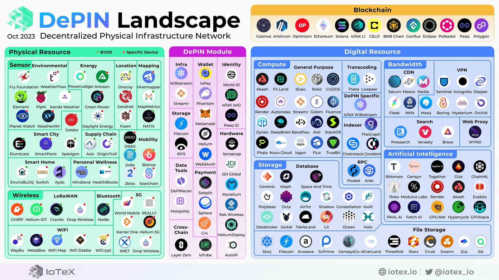

# awesome-depin

>  A curated list of awesome things related to DePIN (Decentralized Physical Infrastructure Networks)

Welcome to our [DePIN (Decentralized Physical Infrastructure Networks)](https://iotex.io/blog/what-are-decentralized-physical-infrastructure-networks-depin/) repository. This is your go-to source for codebases, research papers, projects, and applications. We value your input and contributions - feel free to open an issue or submit a pull request with any proposed changes or additions. Let's make this the best resource for DePIN!

## What is DePIN?

[DePIN](https://iotex.io/blog/what-are-decentralized-physical-infrastructure-networks-depin/), or Decentralized Physical Infrastructure Networks, refers to networks that connect physical hardware devices in a decentralized manner. These networks are supported by cryptocurrency-based rewards and incentives. Also known as [TIPIN](https://medium.com/@mikezajko_16091/token-incentivized-physical-infrastructure-networks-3548b3182d82), [PoPW](https://multicoin.capital/2022/04/05/proof-of-physical-work/), or [EdgeFi](https://medium.com/borderless-capital/edgefi-597b9c747a94), DePIN aims to bridge the digital and physical spaces using crypto-based technologies. It focuses on creating democratized technologies that can compete with or replace centralized offerings. Participants who provide the necessary hardware to the network contribute to its adoption and decentralization, and are rewarded with cryptocurrencies. DePIN has the potential to expand the use cases of cryptocurrencies beyond finance and transactions, driving the development of Web3 and solidifying cryptocurrencies as vital resources.

## The DePIN Landscape

## Projects

### Decentralized Wireless

#### 5G

- [Helium 5G](https://hellohelium.com)
- [XNET](https://www.xnet.company)
- [Karrier One](https://karrier.one)
- [REALLY](https://really.com)
- [Drop Wireless](https://dropwireless.io/)

#### LoRaWAN

- [Helium IoT](https://www.helium.com)
- [Drop Wireless](https://dropwireless.io)
- [Chirp](https://chirptoken.io)
- [Crankk](https://crankk.io)

#### WiFi

- [Metablox](https://metablox.io)
- [Drop Wireless](https://dropwireless.io)
- [Wicrypt](https://wicrypt.com)
- [WifiDabba](https://www.wifidabba.com)

#### Bluetooth Low Energy

- [Nodle](https://www.nodle.com)
- [Drop Wireless](https://dropwireless.io)

#### Hybrid

- [World Mobile](https://worldmobile.io)
- [Fry Networks](https://www.frynetworks.com)
- [Derad Network](https://www.derad.net)

### Decentralized Sensor

#### Mobility

- [DIMO](https://dimo.zone)
- [Hivemapper](https://hivemapper.com)
- [Natix](https://www.natix.network)
- [Mapmetrics](https://mapmetrics.org)
- [Fry Networks](https://www.frynetworks.com)

#### ESG

- [PlanetWatch](https://www.planetwatch.io)
- [WeatherXM](https://weatherxm.com)
- [Weatherflow](https://weatherflow.com)
- [Fry Networks](https://www.frynetworks.com)

#### Geo Location

- [GEODNET](https://geodnet.com)
- [FOAM](https://foam.space)
- [Onocoy](https://www.onocoy.com)
- [Fry Networks](https://www.frynetworks.com)

#### Energy

- [React](https://docs.reactnetwork.io/introduction)
- [Arkreen](https://arkreen.com)
- [Fry Networks](https://www.frynetworks.com)

#### Health

- [Healthblocks](https://www.healthblocks.ai)

#### Smart Home

- [Envirobloq](https://envirobloq.io)
- [PiPhi](https://piphi.network/)

### Decentralized Server

#### Compute

- [StackOS](https://docs.stackos.io/stackos-docs)
- [Render](https://rendertoken.com)
- [Akash](https://akash.network)
- [Gensyn](https://www.gensyn.ai)
- [Cudos](https://www.cudos.org)
- [Dasha Compute](https://getdasha.com)
- [Flux](https://runonflux.io)
- [Aleph](https://aleph.im)
- [Lit](https://litprotocol.com)
- [Functionland](https://fx.land)
- [Golem](https://www.golem.network)
- [iExec](https://iex.ec)
- [Theta](https://www.thetatoken.org)
- [Livepeer](https://livepeer.org)
- [Acurast](https://acurast.com/)
- [Lilypad](https://lilypad.tech)
- [Paralon Cloud](https://paraloncloud.com)
- [Orogen](https://orogen.network)
- [MLX Network](https://mlx.app)
- [LibertAI](https://libertai.io)

#### Storage

- [Filecoin](https://filecoin.io)
- [Arweave](https://www.arweave.org)
- [Sia](https://sia.tech)
- [Storj](https://www.storj.io)
- [Crust](https://crust.network)
- [ScPrime](https://scpri.me)
- [Zus](https://zus.network)
- [4EVERLAND](https://www.4everland.org)
- [Ceramic](https://developers.ceramic.network/docs/introduction/intro)
- [Space and Time](https://www.spaceandtime.io)
- [Kwil](https://www.kwil.com)
- [Swarm](https://www.ethswarm.org/)
- [Xandeum](https://www.xandeum.network)

#### VPN

- [Orchid](https://www.orchid.com)
- [Mysterium](https://www.mysteriumvpn.com)
- [Sentinel](https://sentinel.co)
- [MASQ](https://masq.ai)
- [Fry Networks](https://www.frynetworks.com/)
- [NYM](https://nym.com/)

#### CDN

- [Saturn](https://saturn.tech)
- [Edge](https://edge.network/)

### DePIN Specific Infrastructure

#### Off-chain Compute

- [W3bstream](https://w3bstream.com)
- [Streamr](https://streamr.network)

#### Tools

- [Hotspotty](https://hotspotty.net)
- [Relay](https://www.relaywireless.com)
- [Mycelium Testbed](https://myceliumnetworks.com)

#### L1/L2

- [IoTeX](https://iotex.io)
- [Eclipse](https://www.eclipse.builders)

## Analytics

- [DePIN Pulse - revenue leaderboard](https://depinpulse.app/)
- [wholovesburrito](https://wholovesburrito.com)
- [CoinGecko](https://www.coingecko.com/en/categories/depin)
- [DePINScan](https://depinscan.io/)
- [Pulsar Network](https://pulsarnetwork.xyz)

## Articles

- [State of DePIN 2025 (EV3 and Messari, published 2026)](https://messari.io/report/state-of-depin-2025)
- [A Survey of Decentralized Physical Infrastructure Networks, Research Directions, and Open Challenges (2026)](https://arxiv.org/abs/2609.02125)
- [Decentralized Physical Infrastructure Networks (DePIN) Tokenomics (Frontiers in Blockchain, 2026)](https://www.frontiersin.org/journals/blockchain/articles/10.3389/fbloc.2025.1644115/full)
- [What is DePIN](https://iotex.io/blog/what-are-decentralized-physical-infrastructure-networks-depin/)

## Blogposts and Social Media

- [EV3: Q2 2026 Investor Letter (DePIN postscript)](https://ev3.xyz/research/ev3-investor-letter-q2-26.pdf)
- [Multicoin Capital: The Read Layer for Machine Intelligence (2026)](https://multicoin.capital/2026/09/29/the-read-layer-for-machine-intelligence/)
- [Multicoin Capital: Internet Labor Markets (2026)](https://multicoin.capital/2026/03/10/internet-labor-markets/)
- [a16z crypto: 6 Use Cases for DePIN (2025)](https://a16zcrypto.com/posts/article/6-use-cases-for-depin/)
- [a16z crypto: Manipulated Signals in DePIN Protocols (2025)](https://a16zcrypto.com/posts/article/manipulated-signals-in-depin-protocols/)
- [Syndica: Deep Dive into Solana DePIN, April 2026](https://blog.syndica.io/deep-dive-solana-depin-april-2026/)
- [Helium: The Next Era of the Helium Network (2026)](https://www.helium.com/blog/the-next-era-of-the-helium-network)
- [Connor Lovely](https://substack.com/@connorbuildsinpublic)
- [DePIN State](https://twitter.com/DePINState)
- [Future Money Group](https://twitter.com/fmgroupxyz)
- [Meta Light](https://medium.com/@meta-light)
- [Parlay Labs](https://parleylabs.com/blog/)

## Podcasts

- [DePINed by Fluence (2026 episodes)](https://podcasts.apple.com/us/podcast/depined-podcast/id1765217356)
- [Proof of Coverage Podcast](https://www.youtube.com/channel/UC5u5Po0RmkaSxen-1MF5nJg?app=desktop)
- [The Hotspot Podcast](https://thehotspot.co/)
- [Unleashing DeWi Podcast](https://tunein.com/podcasts/Technology-Podcasts/Unleashing-DeWi-p1989062/)

## Awesome DePIN videos and presentations

- [What is DePIN? The Case for Decentralizing the Real World (a16z crypto, 2026)](https://a16zcrypto.com/posts/videos/what-is-depin-the-case-for-decentralizing-the-real-world/)
- [DePIN Blockchaince Keynote](https://www.youtube.com/watch?v=SKbVfK-fIAs)
- [EthDenver '23: DePIN W3bstream- The next big thing in Web3](https://www.youtube.com/watch?v=jJzY5i3SIV8)
- [Use off-chain price feeds in your DePIN dApp built on IoTeX](https://www.youtube.com/watch?v=x7NlClgGuSk)
- [Build a DePIN bike-sharing dApp with IoTeX (Episode 1)](https://www.youtube.com/watch?v=_8eOv0fmMgE&t=619s)
- [Build a DePIN bike-sharing dApp with IoTeX (Episode 2)](https://www.youtube.com/live/ENteptPNcDo?si=4aaNiTYBtk9tEKd8&t=668)
- [Build a DePIN bike-sharing dApp with IoTeX (Episode 3)](https://www.youtube.com/watch?v=hW8EDrU-UGQ)
- [Solana & IoTeX DePIN Ecosystem](https://youtu.be/53KO9WMeGVw?si=LJaK-NzkwILFVZT7)
- [Sprout Your DePIN Contest](https://www.youtube.com/watch?v=M4XqRz4Hleo)

## Research Conferences, Workshops and Symposiums

- [BRAINS 2026 Workshop on Blockchain & DePIN for Decentralized Energy Systems](https://brains.dnac.org/2026/bdepin-energy/)
- [IEEE International Conference on Blockchain and Cryptocurrency (ICBC 2026)](https://www.comsoc.org/conferences-events/ieee-international-conference-blockchain-and-cryptocurrency-2026)
- [The Second International Workshop on Decentralized Physical Infrastructure Networks (DePIN 2024)](https://icbc2024.ieee-icbc.org/workshop/depin)
- [IEEE International Conference on Blockchain and Cryptocurrency (ICBC 2024)](https://icbc2024.ieee-icbc.org/)
- [The First International Workshop on Decentralized Physical Infrastructure Networks (DePIN 2023)](https://wfiot2023.iot.ieee.org/1st-international-workshop-decentralized-physical-infrastructure-networks-depin-2023)
- [IEEE International Conference on Blockchain and Cryptocurrency (ICBC 2023)](https://icbc2023.ieee-icbc.org/)
- [The 6th IEEE International Conference on Blockchain (Blockchain 2023)](https://ieee-cybermatics.org/2023/blockchain/)
- [International Conference on Blockchain (ICBC 2023)](https://www.servicessociety.org/icbc)
- [The 5th ACM International Symposium on Blockchain and Secure Critical Infrastructure (BSCI 2023)](http://www.cloud-conf.net/bsci/2023/)
- [The Fifth ACM International Workshop on Blockchain-enabled Networked Sensor Systems (BlockSys 2023)](https://acmblocksys.github.io/blocksys2023/)
- [The 3rd EAI International Conference on Blockchain Technology and Emerging Applications (BlockTEA 2023)](https://blocktea.eai-conferences.org/2023/)
- [The 2023 5th Blockchain and Internet of Things Conference (BIOTC 2023)](http://www.biotc.net/)
- [IEEE DePIN Workshop 2023](https://bit.ly/3RO25QD)
